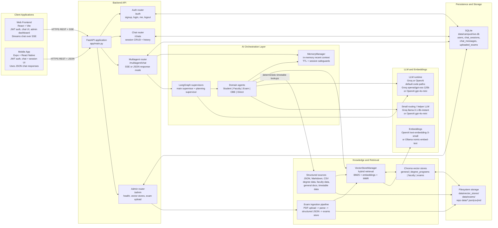

# CampusHive Architecture

This document shows the current high-level architecture of CampusHive as implemented in this repository. It focuses on how the web app and mobile app interact with the backend, where the LLM and retrieval layers fit, and which databases and storage systems are in use.

## High-Level Diagram

## How The Pieces Fit Together

- The web frontend and mobile app both use the same FastAPI backend.
- The web app is the richer client today: it uses streaming responses from `/multiagent/chat` and exposes the admin dashboard.
- The mobile app already reuses the same auth, chat session, and multiagent APIs, but currently calls chat in non-streaming JSON mode.
- Authentication is JWT-based, and chat/session data is persisted in SQLite.
- Multi-agent orchestration is handled by LangGraph supervisors, which route requests into student, faculty, exam, OBE, or direct-response paths.
- Conversation context is kept in the in-memory `MemoryManager` and is hydrated from SQLite-backed chat history when requests arrive.

## Data And AI Layers

- RAG-backed domains use Chroma vector stores managed by `vector_store_manager.py`.
- The current vector stores are `general`, `degree_programs`, `faculty`, and `exams`.
- Timetable answers are not purely vector-search based; they also use structured timetable data from local CSV/JSON sources for deterministic lookups.
- Admin exam uploads go through a background processing flow: PDF upload, LLM-assisted structuring, append to `data/structured_exams.json`, then index into the `exams` vector store.
- LLM selection is configurable in [`config.py`](/Users/ninjascode5/FYP/campushive_v2/config.py). In `auto` mode, the code prefers Groq when a `GROQ_API_KEY` is available; otherwise it falls back to OpenAI. Embeddings prefer OpenAI when `OPENAI_API_KEY` is available, otherwise Ollama.

## Main Request Paths

1. Web or mobile sends auth/session/chat requests to FastAPI.
2. FastAPI authenticates the user, loads prior context, and routes chat traffic into the LangGraph supervisor stack.
3. The supervisor either answers directly or delegates to a domain agent.
4. Agents use the LLM plus either vector retrieval, structured timetable data, or exam-processing flows.
5. Final answers are returned to the client and persisted to SQLite with route metadata.

